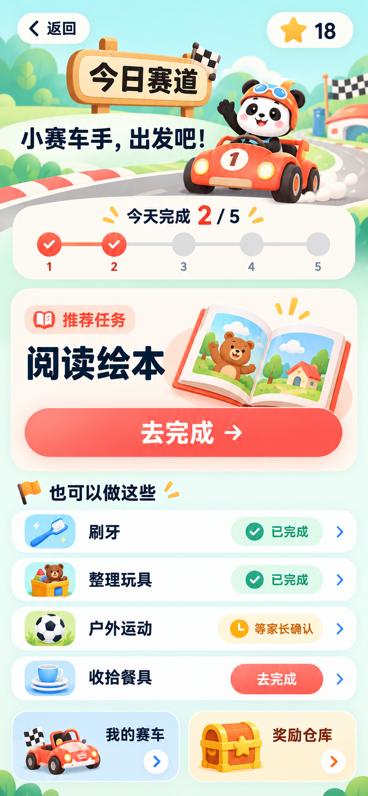

# 今日赛道视觉候选

日期：2026-10-29（北京时间）。使用 Product Design 的视觉探索流程和 Image Gen，根据用户提供的 V1.0 需求、项目主题变量及 [实际首页截图](existing-home.png) 生成。

## 用于评审的修正版

编号对应聊天中**最后连续展示的三张修正版**顺序，不采用前一组初稿。三种布局共用同一产品规则，当前只选择视觉方向，不代表全部页面和业务已经验收。

| 方案 | 设计文件 | 对应生成结果 |
| --- | --- | --- |
| 1 | [查看图片](option-1.png) | `exec-eebcc711-3849-4545-b6e7-04f68f8ae4d9.png` |
| 2 | [查看图片](option-2.png) | `exec-1a98078a-59af-4e2b-8961-46467ecb9d7c.png` |
| 3 | [查看图片](option-3.png) | `exec-29a38595-91c3-451f-98ed-1a3b882d9698.png` |

### 方案 1

### 方案 2

### 方案 3

## 评审边界与后续精修

- 样例为余额 18 星，今日 5 项任务、完成 2 项、1 项等待家长确认。修正版已移除初稿混入的原学习入口与额外任务；初稿不入库。
- 插画是视觉方向素材，不是最终可换装分层资产，也不是精确可操作的任务站点。选定后应重绘可复用的赛车与赛道层，使进度节点、车的位置与业务状态准确对应。
- 方案 3 插画中的个别路标颜色、刷牙说明的扩展文案，以及各方案“去完成”的具体语义，需要在正式页面状态稿中按需求规格统一。不得根据生成图更改任务名称、积分和审核规则。
- 按钮应打开任务指导，不表示立即完成现实任务。所有图中状态仅为示例，不已经写入用户数据。
- 当前图以 390×844 逻辑视口构图，导出像素更高；实际可点击大小、文本裁切、滚动与桌面布局需在实现后测量，不能由图片宣称已通过。
- S02–S08 的统一视觉稿、关键状态、桌面适配、赛车分层素材与动画分镜仍待所选方向细化；其页面规格见 [design-spec.md](../design-spec.md)。

## 功能阶段进展

用户随后要求继续完成全部功能，本轮采用绘本弯道方向实现。上文为设计阶段归档；实际页面、状态与验收记录见 [交付说明](../delivery.md) 和 [真实截图](../screenshots/README.md)。候选图中的前期限制不代表当前功能尚未实现。
