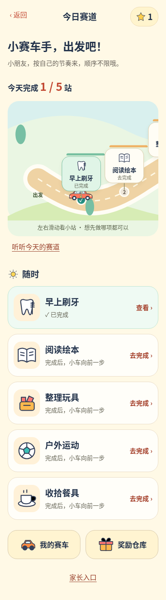
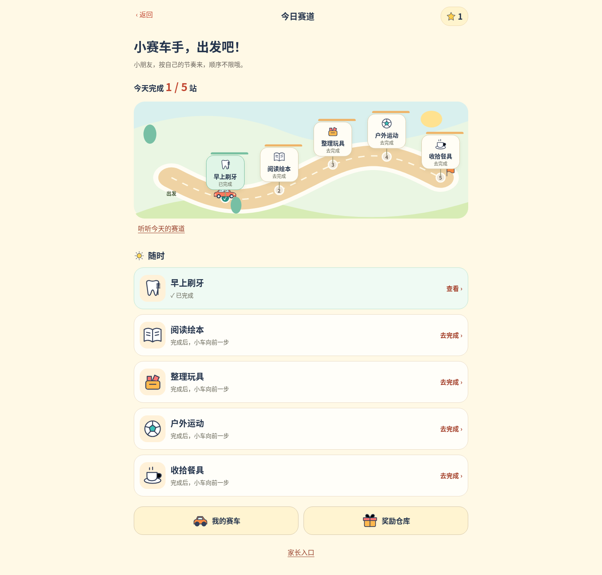
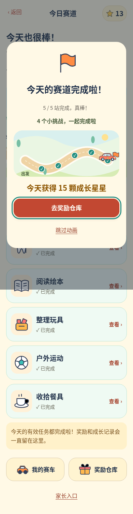
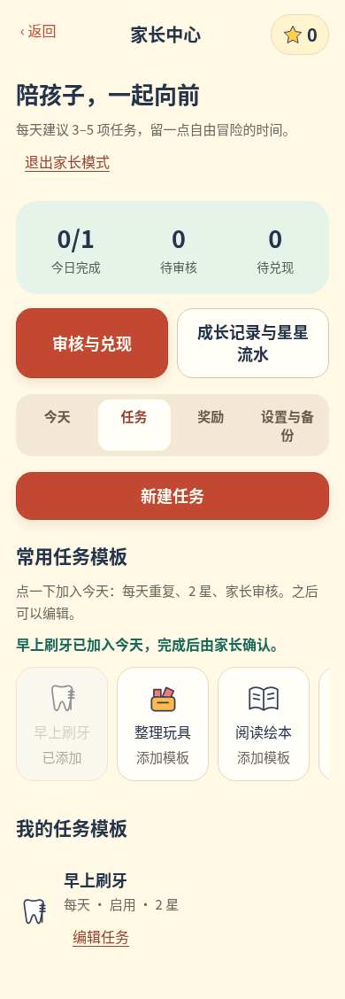
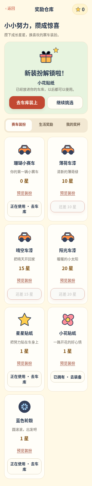
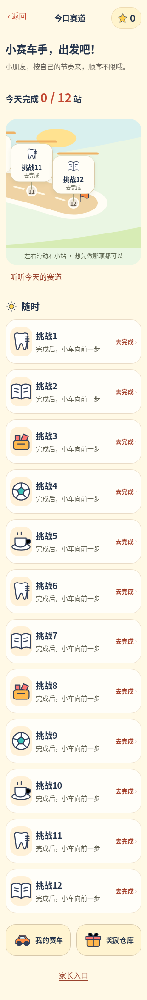

# 赛车成长计划：原需求对齐补完

日期：2026-11-17（北京时间）。基于主分支 `cf97c30`，在独立分支完成审查中的 9 项差异，包括此前的 4 项修复和本轮剩余 5 项。产品规则仍以 [V1.0](requirements-v1.0.md) 为准。

## 现在的使用流程

家长在“任务”页点选推荐模板，直接加入今天，默认每天重复、2 星、家长审核。已有模板不能重复添加，名称修改后仍能识别同一推荐模板。需要调整时使用原编辑器；保存失败保留原数据，不显示“已添加”。

孩子可点赛道上的任务小站或下方分时段任务卡。小站显示真实任务的名称、图标和四种状态；长赛道可以横向查看，控制保持大尺寸。任务顺序仍然自由，车辆按有效任务完成数量前进。

提交保存成功后返回今日赛道。家长审核型任务显示等待，不提前发星或发车；自助任务及家长确认后的任务，由赛道承接一次完成反馈。反馈包含完成印章、星星飞入、沿弯道前进、下一任务建议；全部完成后显示当日所得与短冲线彩带。

数字装扮购买保存成功后显示解锁结果和车库入口。预览只替换当前部位，保留其他已装备部件，不改变保存的搭配。现实奖励继续遵循申请不扣星、批准扣星、取消未兑现奖励退星一次的规则。

## 逐项对照

| 项目 | 实现结果 |
| --- | --- |
| F01 任务地标 | `RaceTrack` 接收真实任务，显示有屋檐的小站、图标、名称、状态，可点选进入详情；增加赛道语音入口。 |
| F02 沿路径行驶 | 路面 SVG 与车辆使用同一坐标来源，动画对路径进度插值，不再沿端点连线移动或另行截断位置。长赛道 SVG 采用无留白缩放。 |
| F03 返回赛道反馈 | 提交成功返回已有赛道父页；深链进入则回到赛道。完成反馈只由赛道承接，继续冒险后仍在赛道。 |
| F04 庆祝与解锁 | 增加有限次飞星、冲线彩带和礼物解锁提示，支持跳过、静音、系统与家长减少动态设置；0 星任务不伪造星星动画。 |
| F05 当日合计 | 以当天任务对应的 earn 流水计算整条赛道所得，和余额、待播放批次分开。例如 5 项各 3 星显示 15 星。 |
| F06 配件预览 | 预览车漆、贴纸或轮毂时只替换所选部位，保留其余装备；预览不扣星。 |
| F07 返回层级 | 详情返回已有赛道；根赛道显式返回学习首页，不依赖 H5 navigateBack 的失败回调。 |
| F08 下一站 | 有待完成任务时显示“下一站可以选”；不强制顺序，不向历史反馈或已完成赛道提供错误建议。 |
| F09 快捷模板 | 新增 addTemplate 事务，统一执行家长验证、幂等添加、日程上限与存储失败保护。 |

## 工程与数据

- `src/utils/racing/track.ts` 是路径坐标来源；修改后运行 `node scripts/generate-racing-track.mjs`。赛车领域测试会检查 SVG 是否与来源一致。
- 动画表现已保存结果，不以动画回调记账；关闭、刷新和跳过不增加重复流水。
- 存储仍为 v1，没有清理旧学习数据或改变原关卡星级。推荐模板采用稳定定义 ID，旧备份沿用既有校验契约。
- 跨端轨迹使用普通计时器与 transform，不依赖浏览器 SVG DOM、CSS motion-path 或新增动效库。SVG 路径 API 只用于浏览器测试。
- 专项回归并入 `npm run test:racing:e2e`，CI 保存 `artifacts/racing-requirements/`。生产部署条件保持原样。GitHub 的 ubuntu-latest 更新至 26.04 后与项目锁定的 Playwright 1.56.1 不兼容，本工作流固定使用受支持的 Ubuntu 24.04。

## 验证与边界

本轮执行类型检查、核心题库与学习记录回归、26 项赛车领域测试、H5 与微信小程序构建、原有 16 项浏览器流程和新增 9 组专项均通过。专项覆盖真实地标点击、0/1/2/12 项布局、车辆中间帧与独立 SVG 路径比对、0 星反馈、有限次飞星与彩带、两种减少动态设置、模板存储故障及装扮解锁。

静态截图不单独作为运动路径的证明。微信开发者工具、微信真机和 iPhone Safari 仍需对应设备手测，不能用编译或 Chromium 尺寸模拟替代。本轮通过独立分支与 PR 交付，不自动合并或部署。

## 本轮实际截图

