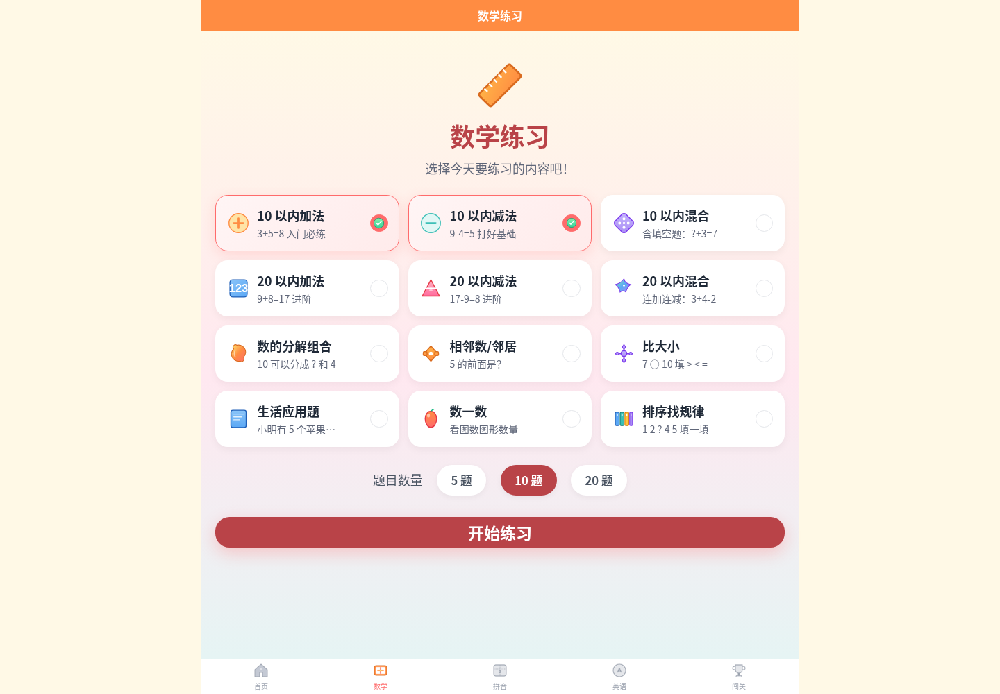
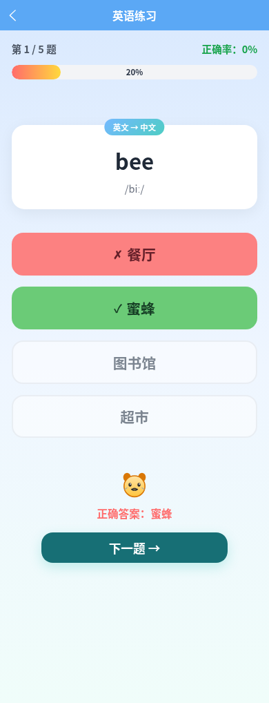
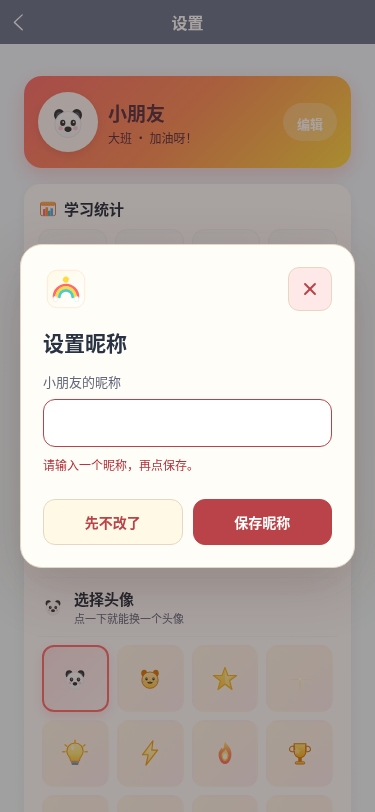

# 网页功能、界面与多屏验收

2026-10-29。本轮对象为彩虹桥 H5 网页的本地生产构建，包含资源导航与全部 16 个互动页面。小程序等待备案后另行构建和发布；原生 App 不属于当前交付。手机尺寸检查是网页检查，不等于 iPhone 真机验收。

本轮采用测试者视角：先采集实际页面截图，复现问题，再修改并运行行为与布局回归。未推送或发布线上，线上版本不自动包含这些修复。

## 验收路径

| 步骤 | 用户任务 | 检查与当前结果 |
| --- | --- | --- |
| 1 | 查找、筛选、收藏资源 | 搜索、年龄与收费交集、只看收藏、刷新保留、移除、清空筛选；通过 |
| 2 | 进入学习首页与切换模块 | 16 个页面可加载；手机、平板、桌面与横屏布局检查；通过 |
| 3 | 数学练习 | 12 类出题、最小候选范围、正确与错误反馈、键盘答题、进度、统计、结算；通过 |
| 4 | 拼音学习与练习 | 声母、韵母、总表、两拼/三拼、所有可选声母、两种练习模式、收藏空态到取消收藏；通过 |
| 5 | 英语学习与练习 | 闪卡翻面/上一张/下一张/认识保存，日常句子页面与朗读入口，两种练习模式、反馈和结算；通过 |
| 6 | 数学闯关 | 首关完整答题、结算、挑战次数、累计统计与保存；通过。全部关卡出题类型和解锁配置作代码检查，未声称每关均逐题人工玩通 |
| 7 | 回看错题 | 实际答错数数题后，题干、原图形与答案均可见；已有移除/清空入口；通过 |
| 8 | 个人信息与设置 | 昵称空白校验、修改与刷新、头像、声音开关、Enter/Space、弹窗 Escape/焦点恢复、重置取消及确认；通过 |

## 本轮复现并修复的问题

| 优先级 | 问题及用户影响 | 修复 |
| --- | --- | --- |
| P0 | 数的分解取总数 2 时，程序死循环凑第四个选项，练习无法开始 | 从有限候选池抽取，允许实际可用选项数少于 4 |
| P1 | 大屏将所有 rpx 文字一起放大；数学三列卡片被挤成逐字竖排 | 限制文字/控件缩放上限，大屏展开内容与网格，统一 uni-app 与页面缩放设置 |
| P1 | 页面默认边距让互动页面宽度多出 8px；小屏出现横向溢出 | 清除 H5 body 默认边距，统一容器盒模型和最大内容宽度 |
| P1 | 拼音 iu/ui 标调错误，例如 níu、lìu | 统一标调工具，验证 niú、liù、jiǔ、shuǐ、huī 等规则 |
| P1 | 同音字成为干扰项，把实际上同样正确的读音判错；有重复选项 | 排除同音歧义，按可见答案去重 |
| P1 | 蜂、交声调错误；拼读中整体认读被拆拼，存在 den/等、lüan/滦 等错误 | 更正题库，剔除错误公式，纠正 ie/üe 分类，统一标调规则 |
| P1 | 收藏空态按钮使用错误跳转方式，无法进入拼音学习 | tabBar 入口改用 switchTab |
| P1 | 数数错题只有文字，没有原题图形，无法复习 | 错题本复用 VisualAid |
| P1 | 英语选项传错组件属性，答后没有对错颜色和禁用反馈 | 使用 OptionButton 的实际属性，并验证不可重复计分 |
| P1 | 数学答题页面没有可聚焦的答题控件，键盘无法操作 | 答题、朗读、页面动作补充角色、焦点与 Enter/Space 操作 |
| P1 | 用 Enter 打开昵称弹窗，松开按键会误触保存并立即关闭 | 在实际输入框捕获遗留 keyup，保留输入框主动 Enter 和确认操作 |
| P1 | 朗读未使用现有录音，拼音字母由浏览器直接读时不可靠；ü 的旧录音为空 | 拼音/常用英语优先播放有效录音，其余使用语音合成；ü 使用同韵母 yu 的有效录音；校验每个映射文件含音频数据 |
| P2 | 开始、闪卡朗读、上一张/认识/下一张等在窄屏不足 44px | 主要动作设定至少 44px 触控高度，图形资产不算作独立操作 |
| P2 | 进度把正在作答的题算作已完成，正确率分母错误 | 分开当前题序和已答数，第一题未答为 0% |
| P2 | 英语选项列表的原子间距样式在 H5 包装节点上未生效，按钮贴邻 | 显式设置选项容器网格间距 |
| P2 | 英语干扰项总取前三项，孩子可猜固定规律 | 随机抽取并去重干扰项 |
| P2 | 学习记录漏存、数学分项不更新、连续打卡不递增、重置嵌套数据残留 | 修正成绩写入、日期和初始数据创建，补充回归 |
| P2 | 闪卡认识记录刷新丢失，头像选择后仍显示固定熊猫 | 接入持久化，并在首页、个人和设置显示已选头像 |
| P2 | 收藏只支持长按，桌面不易发现；新星按钮缺少网页角色 | 提供独立的朗读、收藏按钮，明确角色、标签与键盘操作 |
| P2 | 开关/弹窗与学习页色系不一致、部分状态白字对比不足 | 使用统一珊瑚红/奶油底主题变量，反馈采用深色文字，保留模块彩虹配色 |
| P2 | 设置写“自动建议题目难度”，实际没有难度联动 | 改为准确的“记录当前学习阶段” |

## 多屏与组件检查

尺寸：320×740、375×812、768×1024、1024×768、1440×1000、844×390。

- 16 个互动页面 × 6 个尺寸，共 96 次布局检查；测量文档横向溢出与主要操作触控尺寸。
- 采集 66 张页面截图，包含所有互动页面的手机与桌面视图，以及平板、窄屏和横屏代表页面。原始结果在工作区 `/workspace/qa-kidbridge/after/`；本报告附有选取的原始截图，以及[全部手机页面缩略图](qa-evidence/all-pages-mobile.jpg)、[全部桌面页面缩略图](qa-evidence/all-pages-desktop.jpg)。
- 大屏数学卡片标签宽度必须能正常阅读，避免依赖隐藏溢出来掩盖布局问题。
- 检查 AppDialog、AppSwitch、OptionButton、NumberPad、QuestionCard、ProgressBar、StarRating、VisualAid 的主题、交互状态及动画。主组件增加减少动态效果偏好处理。
- 弹窗校验关联真实 HTML input，而非 uni-app 包装层；检查焦点进入、Esc 返回、Enter 操作和 Space 切换一次。

## 测试与复现

| 项目 | 结果 |
| --- | --- |
| Vue / TypeScript 类型检查 | 通过 |
| 12 类数学题各 1,000 道随机回归 | 通过；算术/分解/比较/应用题等独立核算，选项包含答案且去重 |
| 拼音标调、题库、无歧义选项、拼读结构 | 通过；额外检查全部 250 个题库条目的两种选项模式 |
| 学习统计、日期打卡、收藏、重复重置与声音设置 | 通过 |
| 音频映射的文件存在与非空数据检查 | 通过 |
| 浏览器基础流程、用户旅程、组件及多屏回归 | 三套脚本全部通过、总退出码 0；含 96 次布局检查及关键触控尺寸检查 |
| Python 部署保留与回退测试 | 5 项通过 |
| H5 双入口生产构建 | 通过 |

```bash
npm ci
npm run type-check
npm run test:functional
python3 -m unittest discover -s tests/deployment -v
npm run build:h5

# 另一个终端启动预览，保持运行
python3 -m http.server 4173 --bind 127.0.0.1 --directory dist/build/h5

# 使用 Playwright 自带 Chromium
npx playwright install chromium
npm run test:browser

# 或指定系统 Chromium
CHROMIUM_PATH=/usr/bin/chromium npm run test:browser
```

`test:browser` 包含基础浏览器检查、完整用户旅程、组件与六尺寸回归；核心功能回归已接入现有 CI，浏览器检查当前为本地可复现检查。

最终浏览器日志：[browser-results.txt](qa-evidence/browser-results.txt)。

## 截图证据

截图来自本轮实际运行的网页。完整网格包含全部页面，不能将缩略图当成文字可读性或 WCAG 合规证明。

1. 资源筛选与收藏：正常。


2. 手机首页与模块入口：正常。


3. 桌面数学卡片：竖排挤压已修复。



4. 拼音收藏：朗读与收藏可独立操作，状态正常。


5. 英语答题：正确答案和错误选择均有状态反馈。



6. 闯关列表：状态与关卡入口正常。


7. 数数错题：原图形已恢复，支持复习。


8. 设置：统一主题、验证、昵称与声音操作正常。



## 仍需区分的边界

- 本轮通过的是本地 Chromium 网页验收；iPhone/Safari 真机按此前要求先跳过。不是“小程序和 App 没做完导致网页不能交付”。小程序应在备案完成后另作平台验证。
- 有效音频文件、映射、声音开关和播放入口已检查；未声称所有录音均逐条听音验收，也未声称所有设备都提供相同语音合成能力。
- 资源导航的内部搜索/筛选/收藏已测试，外部 44 个网站的内容和账号/付费流程不是彩虹桥内部功能，沿用独立链接核验记录。
- 截图和 DOM 检查不等于完整读屏器或 WCAG 合规认证。当前未验收全部辅助技术与浏览器组合。
- 主入口 JavaScript 未压缩传输前约 1.2MB，建议后续优化依赖拆分；本轮未把局域网加载速度当成真实弱网性能结论。
- 小班/中班/大班等设置当前记录学习阶段，没有自动调难度；识字/古诗独立模块与跨设备账号同步不在现有网页功能中。

审查维度评分为辅助判断：可访问性 3/4、性能 2/4、响应式 3/4、主题一致性 3/4、实现完整性 3/4，共 14/20。仍保留上述验证边界，不将“测试通过”解释为所有平台、所有边缘场景的无条件保证。
